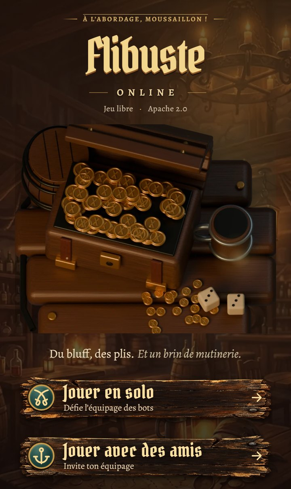
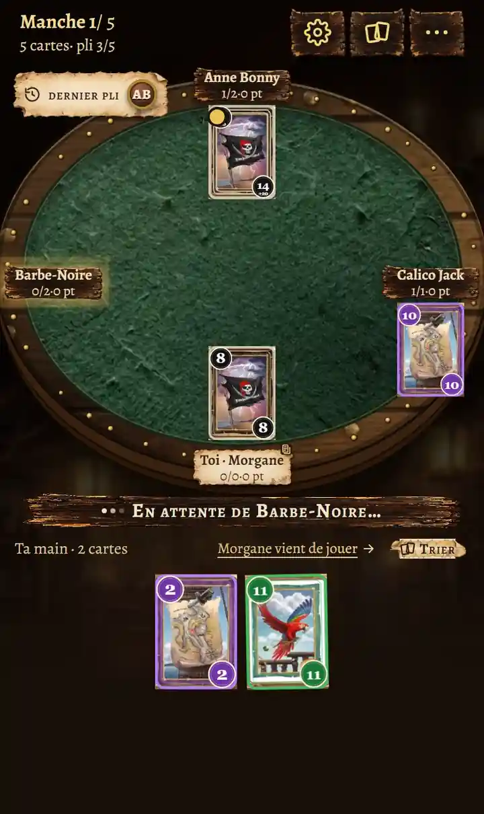

[English](README.md) · **Français**

# Flibuste

**Un jeu de cartes de plis à annonces, sur téléphone.**

<p align="center">
  
  <a href="https://drive.google.com/file/d/112cOo6Wz_5tBT_SFX-D-ywxkpdukOYuf/view"></a>
</p>

*L'accueil et une vraie partie solo contre trois bots (vitesse ×1,5). [Vidéo complète (1 min 31)](https://drive.google.com/file/d/112cOo6Wz_5tBT_SFX-D-ywxkpdukOYuf/view)*

## Utilisation

- **Solo.** Contre des bots de quatre niveaux (Facile, Normal, Difficile, Impitoyable) ou un profil sur mesure ; sans réseau.
- **Entre amis.** L'hôte crée une table et partage un code de six lettres ; de 2 à 8 joueurs (9 avec les numéros bonus) ; des bots peuvent compléter la table.
- **Rythme.** 30 s ou 2 min par tour, sans limite, ou « Au fil de l'eau » : chacun joue quand il peut et reçoit une notification à son tour.
- **Reprise.** Un téléphone fermé retrouve sa place ; après un redémarrage, le serveur rejoue la partie depuis son journal de coups.
- **Installation.** Appli web à ajouter à l'écran d'accueil, avec le son ; règles dans [`docs/REGLES.md`](docs/REGLES.md).

## Architecture

<p align="center"></p>

## Lancer

- **État.** Pas en ligne pour le moment ; se lance en local avec Docker ou Node.js 22.
- **Docker.** Puis ouvrir http://localhost:8787.

  ```sh
  docker build -t flibuste .
  docker run -p 8787:8787 -v flibuste-data:/data flibuste
  ```

- **Node.js.** Réglages : [`.env.example`](.env.example).

  ```sh
  corepack enable && pnpm install
  pnpm --filter @flibuste/web build
  WEB_DIST=$PWD/apps/web/dist pnpm --filter @flibuste/server start
  ```

- **Tests.** `pnpm test` (Vitest, chaque paquet) ; parcours dans un navigateur dans `apps/web/e2e/` (Playwright).
- **Code.** `packages/engine` règles, `packages/bots` bots, `apps/server` serveur, `apps/web` client, `tools/` arène et entraînement des bots, dessin des cartes, encodage des sons.

## Licences

Code : Apache 2.0 ([`LICENSE`](LICENSE), [`NOTICE`](NOTICE)). Textes : CC BY 4.0 ([`LICENSE-docs`](LICENSE-docs)). Polices, sons, images : [`CREDITS.md`](CREDITS.md) ; les illustrations des cartes de l'aperçu viennent de l'ancienne version en ligne, ce dépôt fournit ses propres dessins, plus simples. Flibuste est un jeu indépendant, sans lien avec un éditeur de jeu de société.

---

**Anthony Hunt** · [ingevision.cloud](https://ingevision.cloud/?p=flibuste) · [LinkedIn](https://www.linkedin.com/in/anthony-hunt-3948a9196) · [GitHub](https://github.com/anthohunt)
