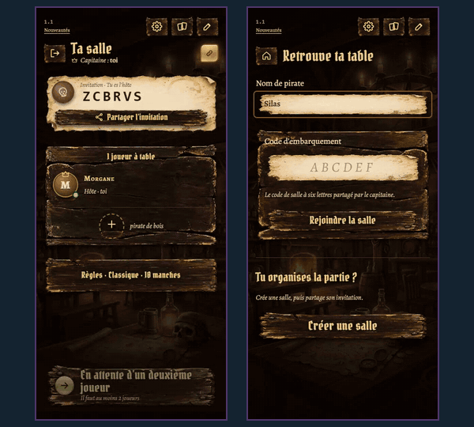
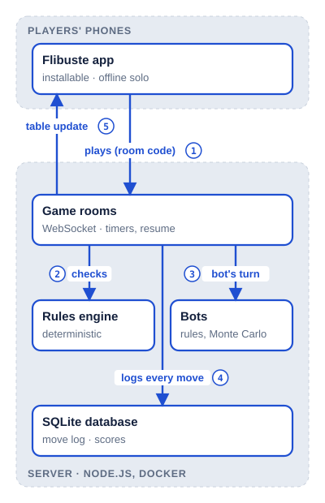

[English](README.md) · **Français**

# Flibuste

**Un jeu de cartes de plis à annonces, sur téléphone.** Seul contre des bots, sans réseau, ou en ligne entre amis qui rejoignent par un code de salle.

*Deux téléphones et un bot dans la même partie en ligne. [Vidéo complète (1 min 52)](https://drive.google.com/file/d/112cOo6Wz_5tBT_SFX-D-ywxkpdukOYuf/view)*

## Utilisation

- **Solo.** Contre des bots de quatre niveaux (Facile, Normal, Difficile, Impitoyable) ou un profil sur mesure ; sans réseau.
- **Entre amis.** L'hôte crée une table et partage un code de six lettres ; de 2 à 8 joueurs, des bots peuvent compléter la table.
- **Rythme.** Un temps limité par tour, ou sans limite ; en mode « Au fil de l'eau », chacun joue quand il peut et reçoit une notification à son tour.
- **Reprise.** Un téléphone fermé ou un serveur redémarré ne met pas fin à la partie : le serveur la rejoue depuis son journal de coups.
- **Installation.** Appli web installable, avec le son ; les règles sont dans [`docs/REGLES.md`](docs/REGLES.md).

## Architecture

## Lancer

- **État.** Pas en ligne pour le moment ; tourne partout avec Docker ou Node.js 22.
- **Docker.** `docker build -t flibuste . && docker run -p 8787:8787 -v flibuste-data:/data flibuste`, puis http://localhost:8787.
- **Node.js.** `corepack enable && pnpm install`, `pnpm --filter @flibuste/web build`, puis `WEB_DIST=apps/web/dist pnpm --filter @flibuste/server start`. Réglages : [`.env.example`](.env.example).
- **Tests.** `pnpm test` (Vitest, chaque paquet) ; parcours dans un navigateur dans `apps/web/e2e/` (Playwright).
- **Code.** `packages/engine` règles, `packages/bots` bots, `apps/server` serveur, `apps/web` client, `tools/` arène des bots et dessin des cartes.

## Licences

Code : Apache 2.0 ([`LICENSE`](LICENSE), [`NOTICE`](NOTICE)). Textes : CC BY 4.0 ([`LICENSE-docs`](LICENSE-docs)). Polices, sons, images : [`CREDITS.md`](CREDITS.md). Flibuste est un jeu indépendant, sans lien avec un éditeur de jeu de société.

---

**Anthony Hunt** · [ingevision.cloud](https://ingevision.cloud/?p=flibuste) · [LinkedIn](https://www.linkedin.com/in/anthony-hunt-3948a9196) · [GitHub](https://github.com/anthohunt)
