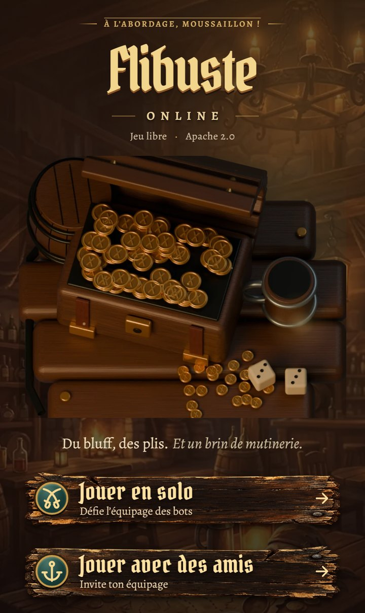
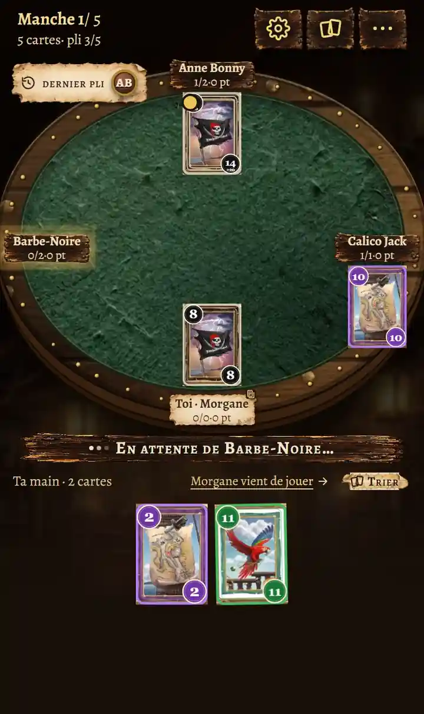
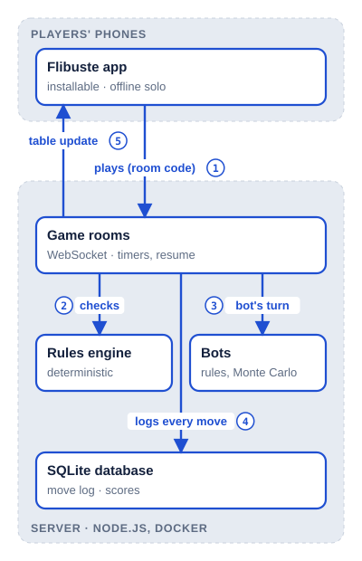

**English** · [Français](README.fr.md)

# Flibuste

**A trick-taking card game with bids, played on a phone.** The game and its rules are in French.

<p align="center">
  
  <a href="https://drive.google.com/file/d/112cOo6Wz_5tBT_SFX-D-ywxkpdukOYuf/view"></a>
</p>

*Home screen and a real solo game against three bots (1.5× speed). [Full video (1:31)](https://drive.google.com/file/d/112cOo6Wz_5tBT_SFX-D-ywxkpdukOYuf/view)*

## Using it

- **Solo.** Against bots at four levels (Facile, Normal, Difficile, Impitoyable) or a custom profile; works without a network.
- **With friends.** The host creates a table and shares a six-letter code; 2 to 8 players (9 with the bonus numbers); bots can fill the table.
- **Pace.** 30 s or 2 min per turn, no limit, or *Au fil de l'eau*: each player plays when they can and gets a notification on their turn.
- **Resume.** A closed phone gets its seat back; after a server restart, the game is rebuilt from its move log.
- **Install.** Web app you add to the home screen, with sound; rules in [`docs/REGLES.md`](docs/REGLES.md).

## Architecture

<p align="center"></p>

## Run it

- **State.** Not hosted at the moment; runs locally with Docker or Node.js 22.
- **Docker.** Then open http://localhost:8787.

  ```sh
  docker build -t flibuste .
  docker run -p 8787:8787 -v flibuste-data:/data flibuste
  ```

- **Node.js.** Settings: [`.env.example`](.env.example).

  ```sh
  corepack enable && pnpm install
  pnpm --filter @flibuste/web build
  WEB_DIST=$PWD/apps/web/dist pnpm --filter @flibuste/server start
  ```

- **Tests.** `pnpm test` (Vitest, each package); browser journeys in `apps/web/e2e/` (Playwright).
- **Code.** `packages/engine` rules, `packages/bots` bots, `apps/server` server, `apps/web` client, `tools/` bot arena and training, card drawing, sound encoding.

## Licenses

Code: Apache 2.0 ([`LICENSE`](LICENSE), [`NOTICE`](NOTICE)). Text: CC BY 4.0 ([`LICENSE-docs`](LICENSE-docs)). Fonts, sounds, images: [`CREDITS.md`](CREDITS.md); the card art in the preview comes from the former hosted version, this repository ships its own simpler drawings. Flibuste is an independent game, not affiliated with any board game publisher.

---

**Anthony Hunt** · [ingevision.cloud](https://ingevision.cloud/?lang=en&p=flibuste) · [LinkedIn](https://www.linkedin.com/in/anthony-hunt-3948a9196) · [GitHub](https://github.com/anthohunt)
